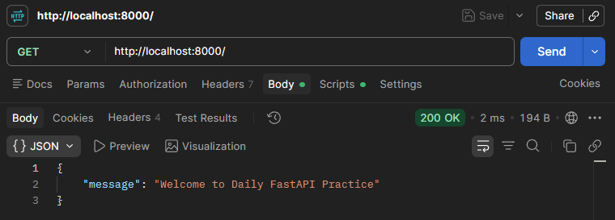
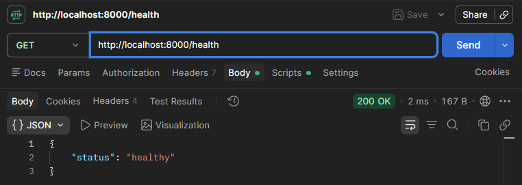
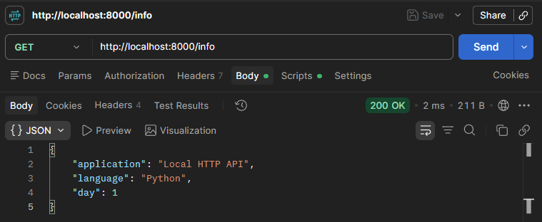
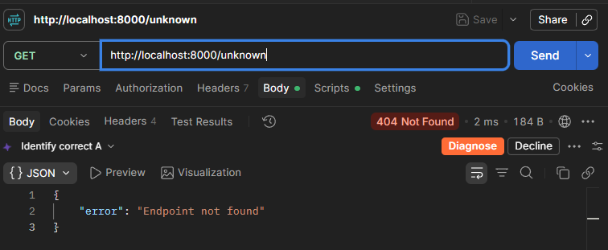
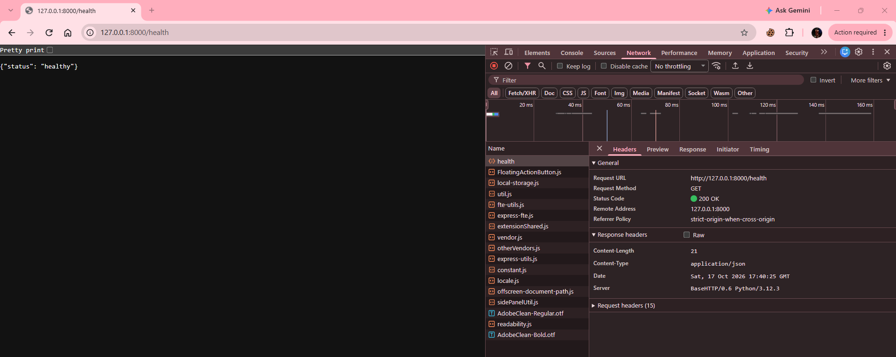

# Day 01 — Tasks Completed

**Date:** 17 October 2026 (Saturday)  
**Project:** Local HTTP API Server  
**Language:** Python 3.12  
**Tools:** PyCharm, Postman, Chrome DevTools  
**Status:** Core Implementation and Testing Completed

---

## Project Overview

Built a local HTTP API server using Python's `http.server` module.

The server handles GET requests, returns JSON responses, and uses appropriate HTTP status codes.

### Endpoints

| Method | Endpoint | Description | Status |
|---|---|---|---|
| GET | `/` | Welcome message | 200 |
| GET | `/health` | Server health | 200 |
| GET | `/info` | Application information | 200 |
| GET | `/unknown` | Unknown route handling | 404 |

---

## Complete Source Code

**File:** `practical/server.py`

```python
from http.server import BaseHTTPRequestHandler, HTTPServer
import json


class APIHandler(BaseHTTPRequestHandler):

    def send_json(self, data, status_code=200):
        """Send a JSON response with the appropriate HTTP status and headers."""

        response = json.dumps(data).encode("utf-8")

        self.send_response(status_code)
        self.send_header("Content-Type", "application/json")
        self.send_header("Content-Length", str(len(response)))
        self.end_headers()

        self.wfile.write(response)

    def do_GET(self):
        """Handle incoming HTTP GET requests."""

        print("Request received:", self.path)

        if self.path == "/":
            self.send_json({
                "message": "Welcome to Daily FastAPI Practice"
            })

        elif self.path == "/health":
            self.send_json({
                "status": "healthy"
            })

        elif self.path == "/info":
            self.send_json({
                "application": "Local HTTP API",
                "language": "Python",
                "day": 1
            })

        else:
            self.send_json({
                "error": "Endpoint not found"
            }, status_code=404)


if __name__ == "__main__":

    HOST = "127.0.0.1"
    PORT = 8000

    server = HTTPServer((HOST, PORT), APIHandler)

    print(f"Server running at http://{HOST}:{PORT}")

    try:
        server.serve_forever()

    except KeyboardInterrupt:
        print("\nStopping server...")

    finally:
        server.server_close()
        print("Server stopped successfully.")
```

---

## Code Explanation

### Variables, Functions, and Classes Reference

| Name | Type | Category | Description |
|---|---|---|---|
| `BaseHTTPRequestHandler` | Class | Standard Library | Base class for handling incoming HTTP requests. |
| `HTTPServer` | Class | Standard Library | Creates an HTTP server that listens for client connections. |
| `json` | Module | Standard Library | Provides JSON serialization and deserialization utilities. |
| `APIHandler` | Class | Custom | Defines the application's HTTP request-handling behavior. |
| `send_json()` | Instance Method | Custom | Sends JSON responses with HTTP status codes and headers. |
| `do_GET()` | Instance Method | Custom Override | Handles GET requests by overriding a standard-library handler method. |
| `self` | Parameter | Python Convention | Refers to the current instance of `APIHandler`. |
| `data` | Parameter | Custom | Holds the Python object to serialize into JSON. |
| `status_code` | Parameter | Custom | Specifies the HTTP response status; defaults to `200`. |
| `response` | Variable | Custom | Stores the UTF-8 encoded JSON response bytes. |
| `self.path` | Instance Attribute | Standard Library | Contains the requested URL path, including any query string. |
| `json.dumps()` | Function | Standard Library | Serializes a Python object into a JSON string. |
| `encode()` | String Method | Built-in Type | Converts a string into bytes using the specified encoding. |
| `send_response()` | Instance Method | Standard Library | Sends the HTTP response status and default headers. |
| `send_header()` | Instance Method | Standard Library | Adds an HTTP response header. |
| `end_headers()` | Instance Method | Standard Library | Marks the end of the HTTP response headers. |
| `self.wfile` | Instance Attribute | Standard Library | Binary output stream used to send response data. |
| `write()` | Stream Method | Standard Library | Writes response bytes to the output stream. |
| `HOST` | Variable | Custom | Stores the local server address, `127.0.0.1`. |
| `PORT` | Variable | Custom | Stores the server port number, `8000`. |
| `server` | Variable | Custom | Holds the `HTTPServer` instance. |
| `__name__` | Module Attribute | Python-Defined | Identifies whether the module is being executed directly or imported. |
| `serve_forever()` | Instance Method | Standard Library | Runs the server's request-handling loop. |
| `server_close()` | Instance Method | Standard Library | Closes the server's listening socket. |
| `KeyboardInterrupt` | Exception Class | Built-in | Represents a user interruption, commonly triggered by `Ctrl + C`. |
| `print()` | Function | Built-in | Displays messages in the terminal. |
| `len()` | Function | Built-in | Returns the length of an object; here, the number of response bytes. |
| `str()` | Function | Built-in | Converts a value into a string. |

**Category Notes:**

- **Custom:** Defined within this project.
- **Built-in:** Provided directly by Python without importing a module.
- **Standard Library:** Provided by Python modules or classes.
- **Custom Override:** Implemented in the project using a method name recognized by a parent class.
- **Python Convention:** A naming convention commonly followed in Python.

---

### Imports

```python
from http.server import BaseHTTPRequestHandler, HTTPServer
import json
```

- `BaseHTTPRequestHandler`: Base class for handling HTTP requests.
- `HTTPServer`: Creates and runs the HTTP server.
- `json`: Converts Python objects into JSON.

### Request Handler

```python
class APIHandler(BaseHTTPRequestHandler):
```

Creates a custom HTTP request handler using inheritance.

### JSON Response Method

```python
def send_json(self, data, status_code=200):
    response = json.dumps(data).encode("utf-8")

    self.send_response(status_code)
    self.send_header("Content-Type", "application/json")
    self.send_header("Content-Length", str(len(response)))
    self.end_headers()

    self.wfile.write(response)
```

- `json.dumps()`: Serializes Python data into JSON.
- `encode("utf-8")`: Converts the JSON string into bytes.
- `send_response()`: Sets the HTTP status code.
- `send_header()`: Adds response headers.
- `end_headers()`: Finishes the header section.
- `wfile.write()`: Sends the response body to the client.

This method avoids repeating response-handling code.

### GET Request Handling

```python
def do_GET(self):
    print("Request received:", self.path)
```

- `do_GET()` handles incoming GET requests.
- `self.path` identifies the requested URL path.
- `print()` logs the requested path.

### Endpoint Routing

```python
if self.path == "/":
    ...

elif self.path == "/health":
    ...

elif self.path == "/info":
    ...

else:
    ...
```

Uses conditional statements to select the appropriate response.

- `/`: Returns a welcome message.
- `/health`: Returns server health information.
- `/info`: Returns application details.
- Other paths: Return HTTP 404 with an error message.

### Server Initialization

```python
HOST = "127.0.0.1"
PORT = 8000

server = HTTPServer((HOST, PORT), APIHandler)
```

Creates a local HTTP server listening on port `8000`.

### Server Execution and Shutdown

```python
try:
    server.serve_forever()

except KeyboardInterrupt:
    print("\nStopping server...")

finally:
    server.server_close()
```

- `serve_forever()`: Keeps the server running.
- `KeyboardInterrupt`: Handles interruption using `Ctrl + C`.
- `server_close()`: Closes the server socket.

---

## Test Results

### Test 1: Welcome Endpoint

**Method:** `GET`  
**URL:** `http://localhost:8000/`  
**Expected Status:** `200 OK`  
**Actual Status:** `200 OK`  
**Result:** PASS

**Response:**

```json
{
    "message": "Welcome to Daily FastAPI Practice"
}
```

**Screenshot:**



---

### Test 2: Health Endpoint

**Method:** `GET`  
**URL:** `http://localhost:8000/health`  
**Expected Status:** `200 OK`  
**Actual Status:** `200 OK`  
**Result:** PASS

**Response:**

```json
{
    "status": "healthy"
}
```

**Screenshot:**



---

### Test 3: Information Endpoint

**Method:** `GET`  
**URL:** `http://localhost:8000/info`  
**Expected Status:** `200 OK`  
**Actual Status:** `200 OK` (server log)  
**Result:** PASS

**Expected Response:**

```json
{
    "application": "Local HTTP API",
    "language": "Python",
    "day": 1
}
```

**Screenshot:**



---

### Test 4: Unknown Endpoint

**Method:** `GET`  
**URL:** `http://localhost:8000/unknown`  
**Expected Status:** `404 Not Found`  
**Actual Status:** `404 Not Found` (server log)  
**Result:** PASS

**Expected Response:**

```json
{
    "error": "Endpoint not found"
}
```

**Screenshot:**



---

### Test 5: Chrome Network Inspection

**Method:** `GET`  
**URL:** `http://127.0.0.1:8000/health`  
**Status:** `200 OK`  
**Content-Type:** `application/json`  
**Content-Length:** `21 bytes`  
**Result:** PASS

**Screenshot:**



---

## Key Learnings

- Created a basic HTTP server using Python.
- Handled GET requests using `do_GET()`.
- Implemented endpoint routing using `self.path`.
- Returned JSON responses with correct HTTP status codes.
- Used a reusable method to avoid code duplication.
- Tested API endpoints using Postman.
- Inspected HTTP headers and responses using Chrome DevTools.
- Understood why undefined routes return HTTP 404.

---

## Final Status

| Item | Status |
|---|---|
| HTTP Server Implementation | Completed |
| GET Endpoint Handling | Completed |
| JSON Response Handling | Completed |
| HTTP 404 Handling | Completed |
| Endpoint Status Testing | 4/4 Passed |
| Chrome Network Inspection | Passed |
| Screenshot Files | Confirm locally |
| Postman Collection | Confirm saved |

**Day 01 Core Practical Assignment: Completed**

> **Next:** Day 02 — REST Architecture and HTTP Methods.