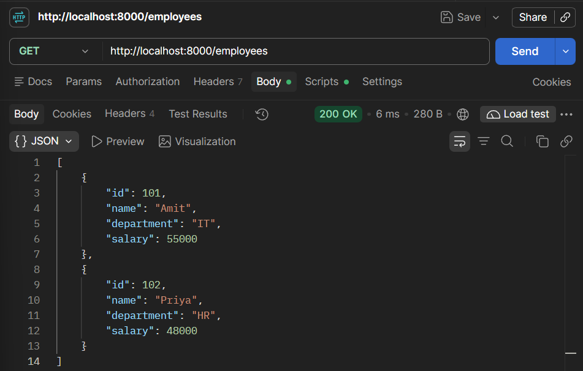
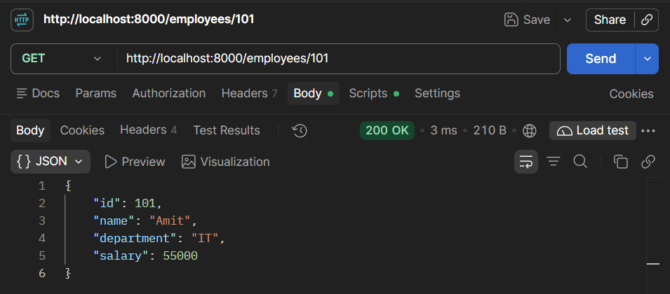
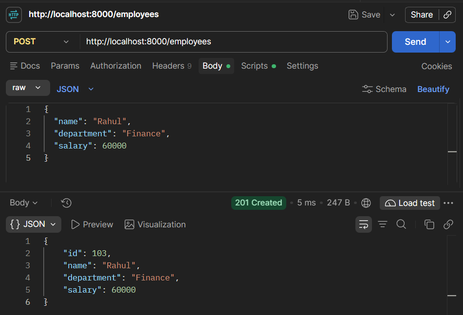
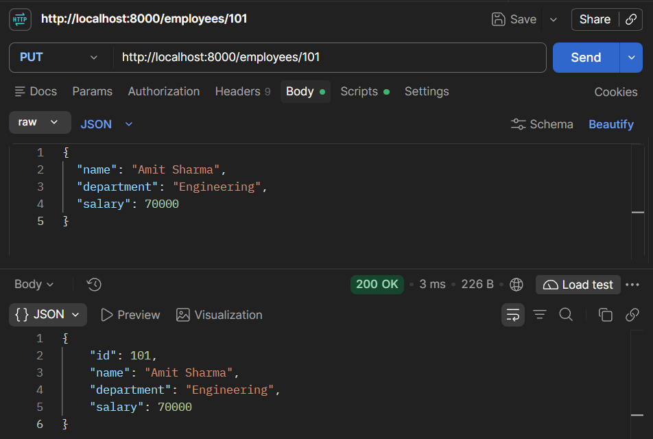
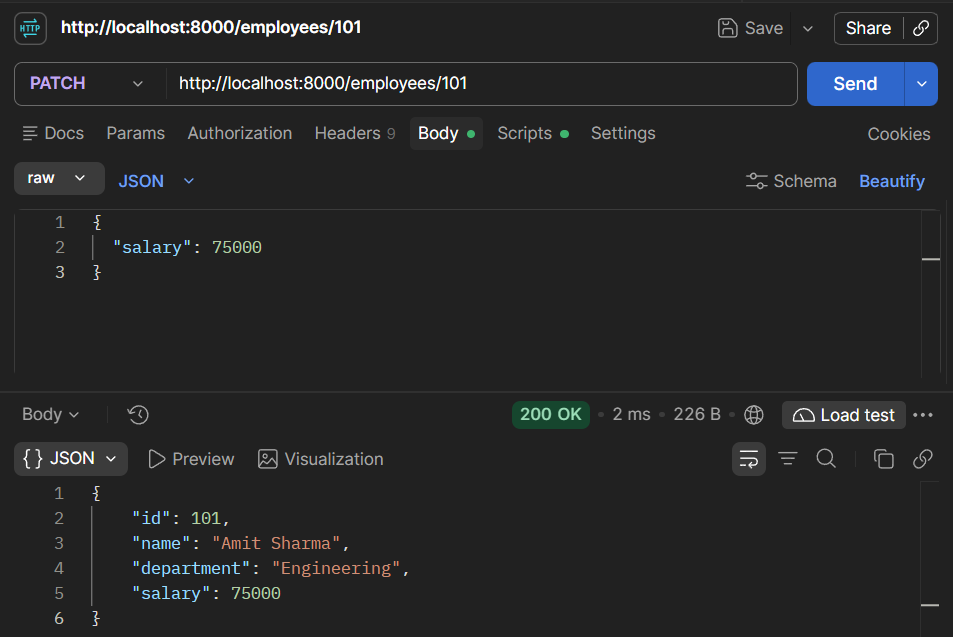
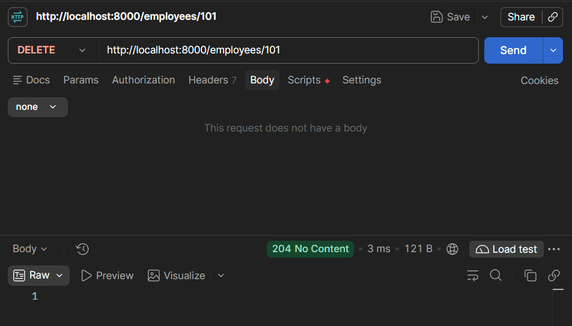
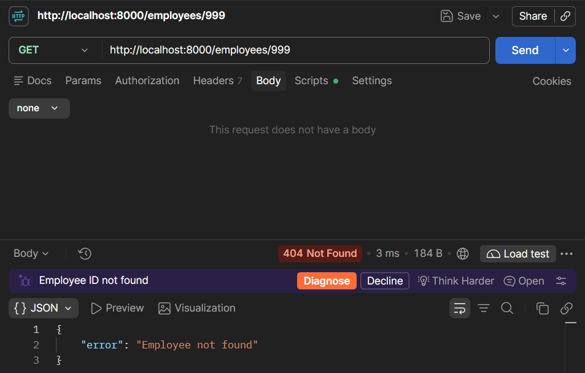
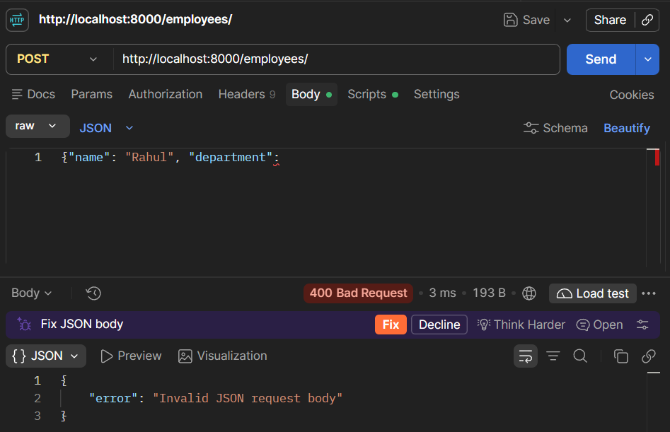
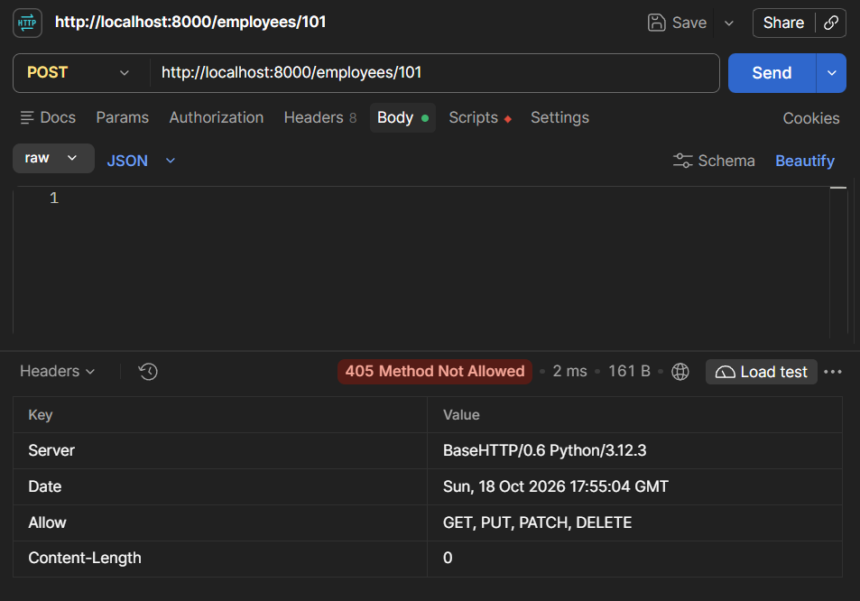

# Day 02 — REST Architecture & HTTP Methods

**Date:** 18 October 2026 (Sunday)\
**Project:** Employee REST API\
**Language:** Python 3.12\
**Tools:** PyCharm, Postman\
**Module:** Python Standard Library (`http.server`, `json`, `urllib.parse`)\
**Implementation:** In-Memory REST API\
**Status:** Ready for Testing

---

## 1. Project Overview

Developed an Employee REST API using Python's built-in `http.server` module to demonstrate resource-oriented API design and HTTP method handling.

The API supports retrieving, creating, replacing, partially updating, and deleting employee records stored in a Python dictionary.

### API Endpoints

| Method | Endpoint         | Description                     | Status Code |
| ------ | ---------------- | ------------------------------- | ----------- |
| GET    | `/employees`     | Retrieve all employees          | 200         |
| GET    | `/employees/101` | Retrieve employee by ID         | 200         |
| POST   | `/employees`     | Create an employee              | 201         |
| PUT    | `/employees/101` | Replace an employee             | 200         |
| PATCH  | `/employees/101` | Partially update an employee    | 200         |
| DELETE | `/employees/101` | Delete an employee              | 204         |
| GET    | `/employees/999` | Employee not found              | 404         |
| POST   | `/employees`     | Invalid JSON request            | 400         |
| POST   | `/employees/101` | Unsupported method for resource | 405         |

**Data Storage:** In-memory Python dictionary. Records reset when the server restarts.

---

## 2. Complete Source Code

**File:** `practical/server.py`

```
from http.server import BaseHTTPRequestHandler, HTTPServer
from urllib.parse import urlsplit
import json


employees = {
    101: {
        "id": 101,
        "name": "Amit",
        "department": "IT",
        "salary": 55000
    },
    102: {
        "id": 102,
        "name": "Priya",
        "department": "HR",
        "salary": 48000
    }
}

next_employee_id = 103

REQUIRED_FIELDS = {"name", "department", "salary"}
ALLOWED_FIELDS = REQUIRED_FIELDS


class APIHandler(BaseHTTPRequestHandler):

    def send_json(self, data, status_code=200, extra_headers=None):
        response = json.dumps(data).encode("utf-8")

        self.send_response(status_code)
        self.send_header("Content-Type", "application/json")
        self.send_header("Content-Length", str(len(response)))

        if extra_headers:
            for name, value in extra_headers.items():
                self.send_header(name, value)

        self.end_headers()
        self.wfile.write(response)

    def send_no_content(self):
        self.send_response(204)
        self.send_header("Content-Length", "0")
        self.end_headers()

    def send_error_json(self, message, status_code):
        self.send_json({"error": message}, status_code)

    def get_resource(self):
        path = urlsplit(self.path).path
        parts = path.strip("/").split("/")

        if parts == ["employees"]:
            return "collection", None

        if len(parts) == 2 and parts[0] == "employees":
            if parts[1].isdigit():
                return "employee", int(parts[1])

        return "unknown", None

    def read_json(self):
        content_type = self.headers.get("Content-Type", "")

        if content_type.split(";")[0].strip().lower() != "application/json":
            self.send_error_json(
                "Content-Type must be application/json",
                415
            )
            return None

        try:
            length = int(self.headers.get("Content-Length", "0"))

            if length <= 0 or length > 1_000_000:
                self.send_error_json(
                    "Request body must contain 1 to 1000000 bytes",
                    400
                )
                return None

            raw_body = self.rfile.read(length)
            data = json.loads(raw_body.decode("utf-8"))

        except (ValueError, UnicodeDecodeError, json.JSONDecodeError):
            self.send_error_json("Invalid JSON request body", 400)
            return None

        if not isinstance(data, dict):
            self.send_error_json(
                "Request body must be a JSON object",
                400
            )
            return None

        return data

    def validate_employee(self, data, partial=False):
        fields = set(data)

        if not partial and fields != REQUIRED_FIELDS:
            return (
                "Employee must contain exactly: "
                "name, department, salary"
            )

        if partial and (
            not fields or not fields.issubset(ALLOWED_FIELDS)
        ):
            return "PATCH requires one or more valid employee fields"

        if "name" in data:
            if not isinstance(data["name"], str) or not data["name"].strip():
                return "name must be a non-empty string"

        if "department" in data:
            if (
                not isinstance(data["department"], str)
                or not data["department"].strip()
            ):
                return "department must be a non-empty string"

        if "salary" in data:
            salary = data["salary"]

            if (
                isinstance(salary, bool)
                or not isinstance(salary, (int, float))
                or salary < 0
            ):
                return "salary must be a non-negative number"

        return None

    def do_GET(self):
        resource, employee_id = self.get_resource()

        if resource == "collection":
            self.send_json(list(employees.values()))

        elif resource == "employee":
            employee = employees.get(employee_id)

            if employee is None:
                self.send_error_json("Employee not found", 404)
            else:
                self.send_json(employee)

        else:
            self.send_error_json("Endpoint not found", 404)

    def do_POST(self):
        global next_employee_id

        resource, _ = self.get_resource()

        if resource == "employee":
            self.send_response(405)
            self.send_header("Allow", "GET, PUT, PATCH, DELETE")
            self.send_header("Content-Length", "0")
            self.end_headers()
            return

        if resource != "collection":
            self.send_error_json("Endpoint not found", 404)
            return

        data = self.read_json()

        if data is None:
            return

        error = self.validate_employee(data)

        if error:
            self.send_error_json(error, 400)
            return

        employee_id = next_employee_id
        next_employee_id += 1

        employee = {
            "id": employee_id,
            **data
        }

        employees[employee_id] = employee

        self.send_json(
            employee,
            201,
            {"Location": f"/employees/{employee_id}"}
        )

    def do_PUT(self):
        resource, employee_id = self.get_resource()

        if resource == "collection":
            self.send_response(405)
            self.send_header("Allow", "GET, POST")
            self.send_header("Content-Length", "0")
            self.end_headers()
            return

        if resource != "employee":
            self.send_error_json("Endpoint not found", 404)
            return

        if employee_id not in employees:
            self.send_error_json("Employee not found", 404)
            return

        data = self.read_json()

        if data is None:
            return

        error = self.validate_employee(data)

        if error:
            self.send_error_json(error, 400)
            return

        employee = {
            "id": employee_id,
            **data
        }

        employees[employee_id] = employee
        self.send_json(employee)

    def do_PATCH(self):
        resource, employee_id = self.get_resource()

        if resource == "collection":
            self.send_response(405)
            self.send_header("Allow", "GET, POST")
            self.send_header("Content-Length", "0")
            self.end_headers()
            return

        if resource != "employee":
            self.send_error_json("Endpoint not found", 404)
            return

        if employee_id not in employees:
            self.send_error_json("Employee not found", 404)
            return

        data = self.read_json()

        if data is None:
            return

        error = self.validate_employee(data, partial=True)

        if error:
            self.send_error_json(error, 400)
            return

        employees[employee_id].update(data)
        self.send_json(employees[employee_id])

    def do_DELETE(self):
        resource, employee_id = self.get_resource()

        if resource == "collection":
            self.send_response(405)
            self.send_header("Allow", "GET, POST")
            self.send_header("Content-Length", "0")
            self.end_headers()
            return

        if resource != "employee":
            self.send_error_json("Endpoint not found", 404)
            return

        if employee_id not in employees:
            self.send_error_json("Employee not found", 404)
            return

        del employees[employee_id]
        self.send_no_content()


if __name__ == "__main__":
    HOST = "127.0.0.1"
    PORT = 8000

    server = HTTPServer((HOST, PORT), APIHandler)

    print(f"Server running at http://{HOST}:{PORT}")

    try:
        server.serve_forever()

    except KeyboardInterrupt:
        print("\nStopping server...")

    finally:
        server.server_close()
        print("Server stopped successfully.")
```

---

## 3. Code Explanation

### 3.1 Imports and Data Store

```
from http.server import BaseHTTPRequestHandler, HTTPServer
from urllib.parse import urlsplit
import json
```

- `BaseHTTPRequestHandler` handles incoming HTTP requests.
- `HTTPServer` creates and runs the server.
- `urlsplit()` separates the URL path from query parameters.
- `json` handles JSON encoding and decoding.

The `employees` dictionary stores records using employee IDs as keys. `next_employee_id` assigns unique IDs to newly created records during the current server session.

### 3.2 JSON Response Handling

```
def send_json(self, data, status_code=200, extra_headers=None):
    response = json.dumps(data).encode("utf-8")

    self.send_response(status_code)
    self.send_header("Content-Type", "application/json")
    self.send_header("Content-Length", str(len(response)))

    if extra_headers:
        for name, value in extra_headers.items():
            self.send_header(name, value)

    self.end_headers()
    self.wfile.write(response)
```

Converts Python data into JSON, sets the HTTP status and response headers, and sends the encoded response body.

### 3.3 Resource Identification

```
def get_resource(self):
    path = urlsplit(self.path).path
    parts = path.strip("/").split("/")

    if parts == ["employees"]:
        return "collection", None

    if len(parts) == 2 and parts[0] == "employees":
        if parts[1].isdigit():
            return "employee", int(parts[1])

    return "unknown", None
```

Distinguishes the employee collection from individual employee resources. Unknown URL patterns are rejected.

### 3.4 Request Parsing and Validation

`read_json()` reads the HTTP request body, verifies the content type, and converts JSON into a Python dictionary.

`validate_employee()` checks required fields and their data types.

- POST and PUT require a complete employee representation.
- PATCH accepts one or more supported fields.
- Invalid input returns an appropriate error response.

### 3.5 GET — Retrieve Records

```
def do_GET(self):
    resource, employee_id = self.get_resource()

    if resource == "collection":
        self.send_json(list(employees.values()))

    elif resource == "employee":
        employee = employees.get(employee_id)

        if employee is None:
            self.send_error_json("Employee not found", 404)
        else:
            self.send_json(employee)

    else:
        self.send_error_json("Endpoint not found", 404)
```

Returns all employees or a specific employee without modifying stored records.

### 3.6 POST — Create Records

The `do_POST()` method:

1. Validates the collection endpoint.
2. Reads and validates the JSON body.
3. Assigns a new employee ID.
4. Stores the employee.
5. Returns `201 Created` with a `Location` header.

### 3.7 PUT — Replace Records

The `do_PUT()` method validates a complete employee representation and replaces the existing record while preserving its resource ID.

Repeating the same PUT request produces the same stored representation.

### 3.8 PATCH — Update Selected Fields

```
employees[employee_id].update(data)
self.send_json(employees[employee_id])
```

Updates only the supplied fields. Existing fields not included in the request remain unchanged.

### 3.9 DELETE — Remove Records

```
del employees[employee_id]
self.send_no_content()
```

Removes the specified employee and returns `204 No Content` with an empty response body.

### 3.10 Server Initialization

```
HOST = "127.0.0.1"
PORT = 8000

server = HTTPServer((HOST, PORT), APIHandler)
server.serve_forever()
```

Starts the server on the local loopback interface. The complete implementation also handles `KeyboardInterrupt` and closes the server socket during shutdown.

### Important Classes, Functions, and Variables

| Name                     | Type       | Category         | Description                   |
| ------------------------ | ---------- | ---------------- | ----------------------------- |
| `BaseHTTPRequestHandler` | Class      | Standard Library | Base HTTP request handler     |
| `HTTPServer`             | Class      | Standard Library | HTTP server implementation    |
| `urlsplit()`             | Function   | Standard Library | Separates URL components      |
| `json.loads()`           | Function   | Standard Library | Decodes JSON                  |
| `json.dumps()`           | Function   | Standard Library | Encodes JSON                  |
| `APIHandler`             | Class      | Custom           | Employee API request handler  |
| `send_json()`            | Method     | Custom           | Sends JSON responses          |
| `send_no_content()`      | Method     | Custom           | Sends an empty 204 response   |
| `send_error_json()`      | Method     | Custom           | Sends JSON error responses    |
| `get_resource()`         | Method     | Custom           | Identifies requested resource |
| `read_json()`            | Method     | Custom           | Parses request JSON           |
| `validate_employee()`    | Method     | Custom           | Validates employee fields     |
| `do_GET()`               | Method     | Overridden       | Handles GET requests          |
| `do_POST()`              | Method     | Overridden       | Handles POST requests         |
| `do_PUT()`               | Method     | Overridden       | Handles PUT requests          |
| `do_PATCH()`             | Method     | Overridden       | Handles PATCH requests        |
| `do_DELETE()`            | Method     | Overridden       | Handles DELETE requests       |
| `employees`              | Dictionary | Custom           | In-memory employee data       |
| `next_employee_id`       | Integer    | Custom           | Next available employee ID    |
| `REQUIRED_FIELDS`        | Set        | Custom           | Required employee fields      |
| `ALLOWED_FIELDS`         | Set        | Custom           | Permitted update fields       |
| `self.path`              | Attribute  | Standard Library | Requested URL path            |
| `self.headers`           | Attribute  | Standard Library | Incoming request headers      |
| `self.rfile`             | Stream     | Standard Library | Reads request body            |
| `self.wfile`             | Stream     | Standard Library | Writes response body          |
| `send_response()`        | Method     | Standard Library | Sets HTTP status              |
| `send_header()`          | Method     | Standard Library | Adds response headers         |
| `end_headers()`          | Method     | Standard Library | Ends response headers         |
| `serve_forever()`        | Method     | Standard Library | Runs server loop              |
| `server_close()`         | Method     | Standard Library | Closes server socket          |
| `HOST`                   | String     | Custom           | Server binding address        |
| `PORT`                   | Integer    | Custom           | Server listening port         |

---

## 4. Test Results

**Testing Tool:** Postman  
**Base URL:** `http://127.0.0.1:8000`  
**Status:** Awaiting actual execution and verification

For POST, PUT, and PATCH requests, select **Body → raw → JSON** in Postman.

### Test 1: Retrieve All Employees

**Method:** GET  
**URL:** `http://127.0.0.1:8000/employees`  
**Expected Status:** 200 OK  
**Actual Status:** Pending

**Expected Response:**

```json
[
  {
    "id": 101,
    "name": "Amit",
    "department": "IT",
    "salary": 55000
  },
  {
    "id": 102,
    "name": "Priya",
    "department": "HR",
    "salary": 48000
  }
]
```

**Screenshot:**



---

### Test 2: Retrieve Specific Employee

**Method:** GET  
**URL:** `http://127.0.0.1:8000/employees/101`  
**Expected Status:** 200 OK  
**Actual Status:** Pending

**Expected Response:**

```json
{
  "id": 101,
  "name": "Amit",
  "department": "IT",
  "salary": 55000
}
```

**Screenshot:**



---

### Test 3: Create Employee

**Method:** POST  
**URL:** `http://127.0.0.1:8000/employees`  
**Expected Status:** 201 Created  
**Actual Status:** Pending

**Request Body:**

```json
{
  "name": "Rahul",
  "department": "Finance",
  "salary": 60000
}
```

**Expected Response:**

```json
{
  "id": 103,
  "name": "Rahul",
  "department": "Finance",
  "salary": 60000
}
```

**Expected Response Header:**

```http
Location: /employees/103
```

**Screenshot:**



---

### Test 4: Replace Employee

**Method:** PUT  
**URL:** `http://127.0.0.1:8000/employees/101`  
**Expected Status:** 200 OK  
**Actual Status:** Pending

**Request Body:**

```json
{
  "name": "Amit Sharma",
  "department": "Engineering",
  "salary": 70000
}
```

**Expected Response:**

```json
{
  "id": 101,
  "name": "Amit Sharma",
  "department": "Engineering",
  "salary": 70000
}
```

**Screenshot:**



---

### Test 5: Partially Update Employee

**Method:** PATCH  
**URL:** `http://127.0.0.1:8000/employees/101`  
**Expected Status:** 200 OK  
**Actual Status:** Pending

**Request Body:**

```json
{
  "salary": 75000
}
```

**Expected Response:**

```json
{
  "id": 101,
  "name": "Amit Sharma",
  "department": "Engineering",
  "salary": 75000
}
```

**Screenshot:**



---

### Test 6: Delete Employee

**Method:** DELETE  
**URL:** `http://127.0.0.1:8000/employees/101`  
**Expected Status:** 204 No Content  
**Actual Status:** Pending

**Expected Response:** Empty body.

**Screenshot:**



---

### Test 7: Employee Not Found

**Method:** GET  
**URL:** `http://127.0.0.1:8000/employees/999`  
**Expected Status:** 404 Not Found  
**Actual Status:** Pending

**Expected Response:**

```json
{
  "error": "Employee not found"
}
```

**Screenshot:**



---

### Test 8: Invalid JSON Request

**Method:** POST  
**URL:** `http://127.0.0.1:8000/employees`  
**Expected Status:** 400 Bad Request  
**Actual Status:** Pending

**Request Body (intentionally malformed):**

```text
{"name": "Rahul", "department":
```

**Expected Response:**

```json
{
  "error": "Invalid JSON request body"
}
```

**Screenshot:**



### Test 9: Method Not Allowed

**Method:** POST  
**URL:** `http://127.0.0.1:8000/employees/101`  
**Expected Status:** 405 Method Not Allowed  
**Actual Status:** Pending

**Expected Response:** Empty body.

**Expected Header:**

```http
Allow: GET, PUT, PATCH, DELETE
```

**Screenshot:**




## 5. Key Learnings

- REST organizes API endpoints around resources.
- GET retrieves data without intentionally modifying server state.
- POST creates new employee records.
- PUT replaces an existing resource representation.
- PATCH modifies selected fields.
- DELETE removes a resource.
- HTTP status codes communicate operation outcomes.
- JSON enables structured data exchange between client and server.
- In-memory storage is temporary and does not provide persistence.
- Idempotency concerns the intended server-side effect of repeated requests, not identical responses.

---

## 6. Final Status

| Requirement                        | Status   |
| ---------------------------------- | -------- |
| Source code prepared               | Complete |
| GET implementation                 | Prepared |
| POST implementation                | Prepared |
| PUT implementation                 | Prepared |
| PATCH implementation               | Prepared |
| DELETE implementation              | Prepared |
| JSON validation and error handling | Prepared |
| Postman testing                    | Pending  |
| Screenshots captured               | Pending  |
| Documentation verified             | Pending  |
| GitHub upload                      | Pending  |

**Day 02 Status:** Implementation prepared — awaiting execution and testing.

**Next Session:** Day 03 — FastAPI Fundamentals, Application Setup, and Basic Routing.

Testing order matters: Run Tests 1–9 sequentially after starting the server, since PUT and PATCH modify employee 101 and DELETE removes it. Restart the server if you want to restore the original employee records.