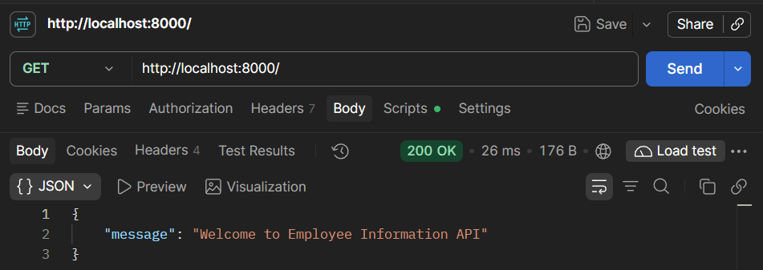
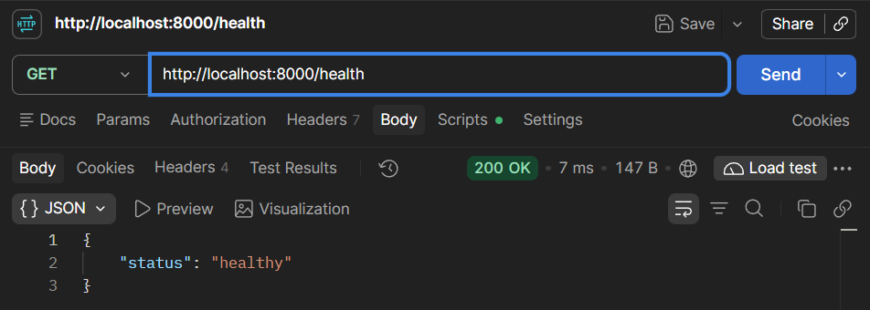
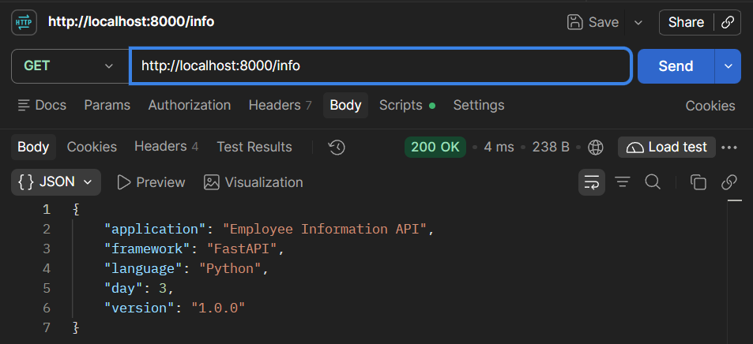
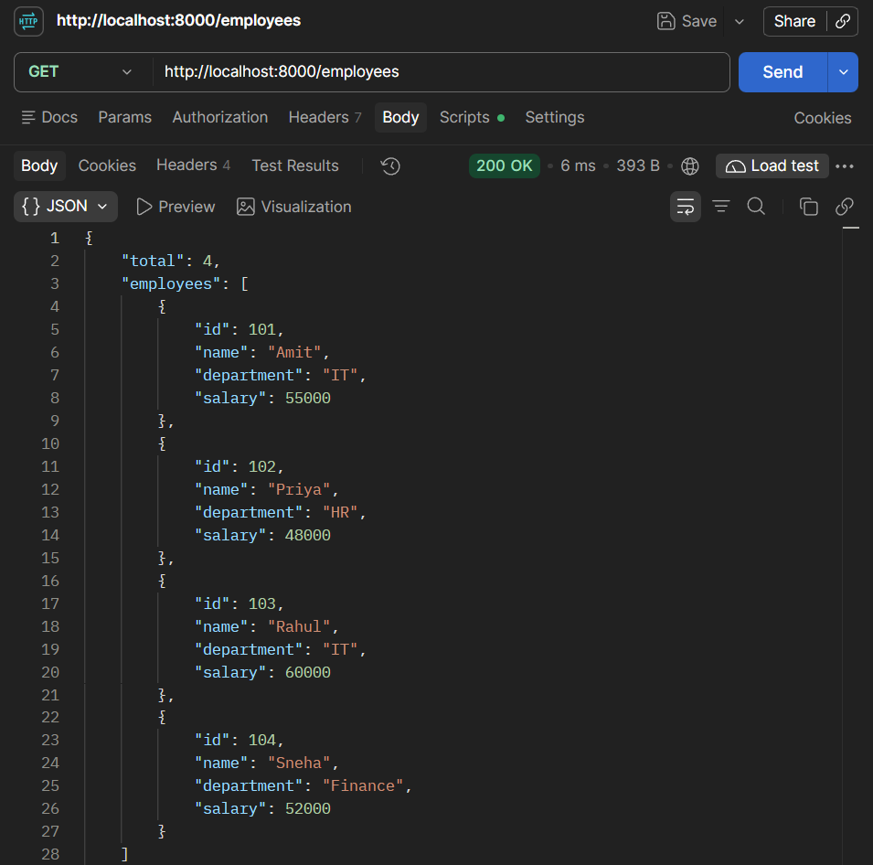
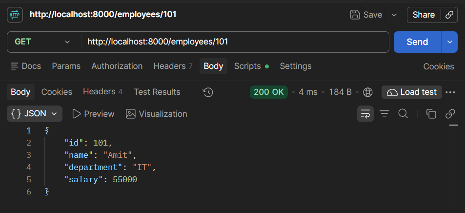
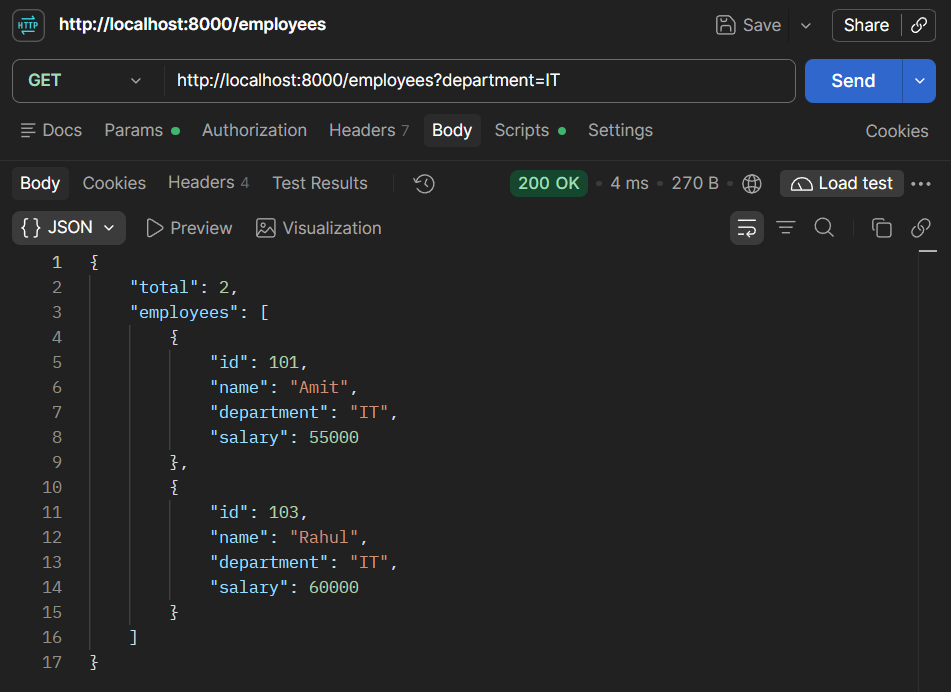
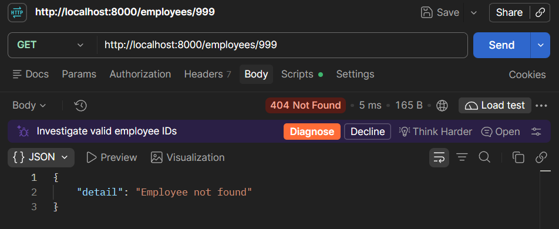
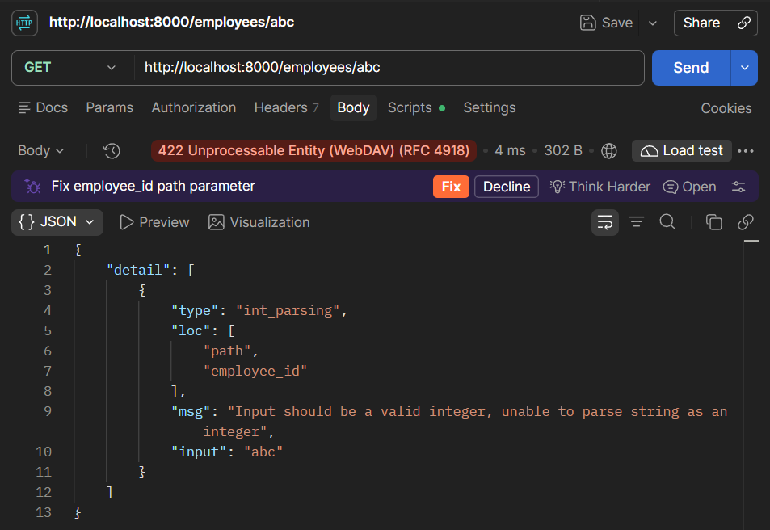
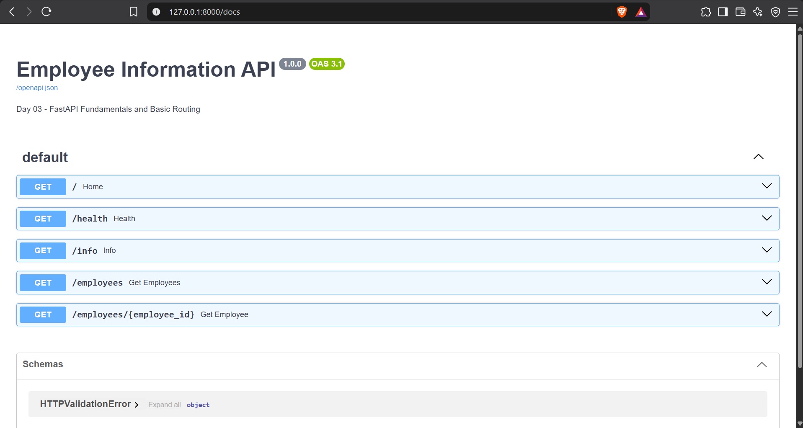
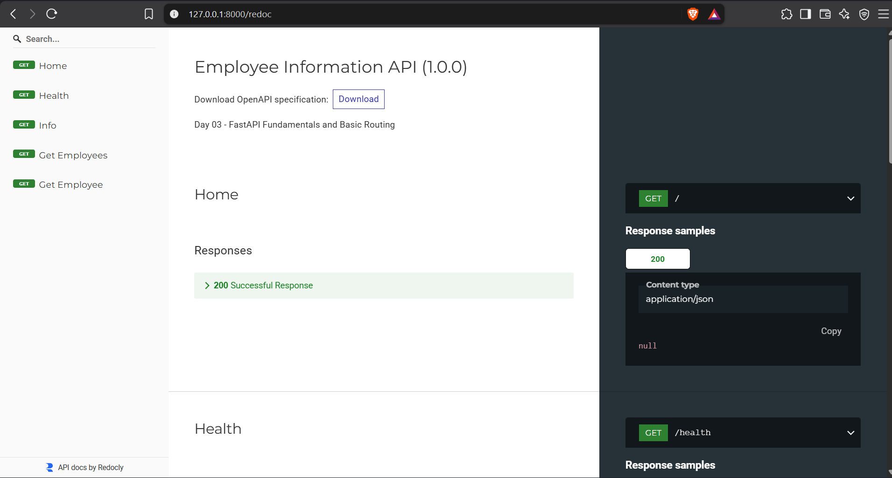

# Day 03 — FastAPI Fundamentals & Basic Routing

**Date:** 19 October 2026 (Monday)  
**Project:** Employee Information API  
**Language:** Python 3.12  
**Framework:** FastAPI  
**Tools:** PyCharm, Uvicorn, Postman  
**Data Storage:** In-Memory Python Dictionary  
**Status:** Ready for Testing

---

## 1. Project Overview

Developed an Employee Information API using FastAPI to understand application setup, routing, path parameters, query parameters, automatic validation, and API documentation.

The application supports retrieving employee information, filtering employees by department, and handling missing or invalid resource identifiers.

### API Endpoints

| Method | Endpoint | Description | Expected Status |
|---|---|---|---|
| GET | `/` | Welcome message | 200 |
| GET | `/health` | Server health check | 200 |
| GET | `/info` | Application information | 200 |
| GET | `/employees` | Retrieve all employees | 200 |
| GET | `/employees/101` | Retrieve employee by ID | 200 |
| GET | `/employees?department=IT` | Filter employees by department | 200 |
| GET | `/employees/999` | Employee not found | 404 |
| GET | `/employees/abc` | Invalid employee ID | 422 |

**Additional Features:**
- Automatic JSON serialization.
- Type validation using Python annotations.
- Interactive Swagger UI documentation.
- ReDoc API documentation.

---

## 2. Complete Source Code

**File:** `practical/main.py`

```python
from fastapi import FastAPI, HTTPException

app = FastAPI(
    title="Employee Information API",
    description="Day 03 - FastAPI Fundamentals and Basic Routing",
    version="1.0.0"
)


employees = {
    101: {
        "id": 101,
        "name": "Amit",
        "department": "IT",
        "salary": 55000
    },
    102: {
        "id": 102,
        "name": "Priya",
        "department": "HR",
        "salary": 48000
    },
    103: {
        "id": 103,
        "name": "Rahul",
        "department": "IT",
        "salary": 60000
    },
    104: {
        "id": 104,
        "name": "Sneha",
        "department": "Finance",
        "salary": 52000
    }
}


@app.get("/")
def home():
    return {
        "message": "Welcome to Employee Information API"
    }


@app.get("/health")
def health():
    return {
        "status": "healthy"
    }


@app.get("/info")
def info():
    return {
        "application": "Employee Information API",
        "framework": "FastAPI",
        "language": "Python",
        "day": 3,
        "version": "1.0.0"
    }


@app.get("/employees")
def get_employees(department: str | None = None):

    employee_list = list(employees.values())

    if department is not None:
        employee_list = [
            employee
            for employee in employee_list
            if employee["department"].lower() == department.lower()
        ]

    return {
        "total": len(employee_list),
        "employees": employee_list
    }


@app.get("/employees/{employee_id}")
def get_employee(employee_id: int):

    employee = employees.get(employee_id)

    if employee is None:
        raise HTTPException(
            status_code=404,
            detail="Employee not found"
        )

    return employee


if __name__ == "__main__":
    import uvicorn

    uvicorn.run(
        app,
        host="127.0.0.1",
        port=8000
    )
```

---

## 3. Code Explanation

### 3.1 Imports and Application Initialization

```python
from fastapi import FastAPI, HTTPException

app = FastAPI(
    title="Employee Information API",
    description="Day 03 - FastAPI Fundamentals and Basic Routing",
    version="1.0.0"
)
```

**Explanation:**

- `FastAPI` creates the API application.
- `HTTPException` generates HTTP error responses.
- `title`, `description`, and `version` configure API metadata displayed in the documentation.

### 3.2 Employee Data Store

```python
employees = {
    101: {
        "id": 101,
        "name": "Amit",
        "department": "IT",
        "salary": 55000
    },
    102: {
        "id": 102,
        "name": "Priya",
        "department": "HR",
        "salary": 48000
    },
    103: {
        "id": 103,
        "name": "Rahul",
        "department": "IT",
        "salary": 60000
    },
    104: {
        "id": 104,
        "name": "Sneha",
        "department": "Finance",
        "salary": 52000
    }
}
```

**Explanation:**

Employee IDs are dictionary keys, allowing direct record lookup using `employees.get(employee_id)`.

Data is stored temporarily in memory and resets when the application restarts.

### 3.3 Home Endpoint

```python
@app.get("/")
def home():
    return {
        "message": "Welcome to Employee Information API"
    }
```

**Explanation:**

- `@app.get("/")` registers a GET route.
- `home()` executes when the root endpoint is requested.
- FastAPI automatically serializes the returned dictionary into JSON.

### 3.4 Health Check Endpoint

```python
@app.get("/health")
def health():
    return {
        "status": "healthy"
    }
```

**Explanation:**

Provides a basic endpoint to verify that the API application is responding.

### 3.5 Application Information Endpoint

```python
@app.get("/info")
def info():
    return {
        "application": "Employee Information API",
        "framework": "FastAPI",
        "language": "Python",
        "day": 3,
        "version": "1.0.0"
    }
```

**Explanation:**

Returns basic application metadata as a JSON response.

### 3.6 Retrieve and Filter Employees

```python
@app.get("/employees")
def get_employees(department: str | None = None):

    employee_list = list(employees.values())

    if department is not None:
        employee_list = [
            employee
            for employee in employee_list
            if employee["department"].lower() == department.lower()
        ]

    return {
        "total": len(employee_list),
        "employees": employee_list
    }
```

**Explanation:**

- `department: str | None = None` defines an optional query parameter.
- `employees.values()` retrieves all employee records.
- `list()` converts the dictionary values into a list.
- The list comprehension filters employees by department.
- `.lower()` enables case-insensitive matching.
- `len()` calculates the number of matching employees.

**Example:**

```http
GET /employees?department=IT
```

Returns only employees belonging to the IT department.

### 3.7 Retrieve Employee by ID

```python
@app.get("/employees/{employee_id}")
def get_employee(employee_id: int):

    employee = employees.get(employee_id)

    if employee is None:
        raise HTTPException(
            status_code=404,
            detail="Employee not found"
        )

    return employee
```

**Explanation:**

- `{employee_id}` defines a dynamic path parameter.
- `employee_id: int` requires an integer value.
- `employees.get()` searches for the employee.
- `HTTPException` returns a 404 response when the employee does not exist.
- FastAPI automatically returns a 422 response for an invalid integer path parameter.

### 3.8 Running the Application

**Install Dependencies:**

```bash
pip install fastapi uvicorn
```

**Start Development Server:**

From the `practical` directory:

```bash
uvicorn main:app --reload
```

**Server URL:**

```text
http://127.0.0.1:8000
```

**Alternative Execution:**

```bash
python main.py
```

The alternative starts the server without automatic reloading.

### Important Classes, Functions, and Variables

| Name | Type | Category | Description |
|---|---|---|---|
| `FastAPI` | Class | Third-Party | Creates the API application |
| `HTTPException` | Class | Third-Party | Generates HTTP error responses |
| `uvicorn` | Module | Third-Party | Runs the ASGI application |
| `app` | Object | Custom | FastAPI application instance |
| `employees` | Dictionary | Custom | Stores employee records |
| `home()` | Function | Custom | Handles root endpoint |
| `health()` | Function | Custom | Handles health check |
| `info()` | Function | Custom | Returns application information |
| `get_employees()` | Function | Custom | Retrieves and filters employees |
| `get_employee()` | Function | Custom | Retrieves an employee by ID |
| `@app.get()` | Decorator | FastAPI | Registers a GET endpoint |
| `employee_id` | Parameter | Custom | Employee resource identifier |
| `department` | Parameter | Custom | Optional department filter |
| `employee_list` | List | Custom | Holds employee records |
| `list()` | Function | Built-in | Converts an iterable into a list |
| `len()` | Function | Built-in | Returns the number of items |
| `.values()` | Method | Built-in | Retrieves dictionary values |
| `.get()` | Method | Built-in | Retrieves a dictionary value by key |
| `.lower()` | Method | Built-in | Converts a string to lowercase |
| `raise` | Statement | Python Keyword | Raises an exception |
| `uvicorn.run()` | Function | Third-Party | Starts the ASGI server |

---

## 4. Test Results

**Testing Tool:** Postman  
**Base URL:** `http://127.0.0.1:8000`  
**Status:** Awaiting actual execution and verification

### Test 1: Home Endpoint

**Method:** GET  
**URL:** `http://127.0.0.1:8000/`  
**Expected Status:** 200 OK  
**Actual Status:** Pending

**Expected Response:**

```json
{
  "message": "Welcome to Employee Information API"
}
```

**Screenshot:**



---

### Test 2: Health Check

**Method:** GET  
**URL:** `http://127.0.0.1:8000/health`  
**Expected Status:** 200 OK  
**Actual Status:** Pending

**Expected Response:**

```json
{
  "status": "healthy"
}
```

**Screenshot:**



---

### Test 3: Application Information

**Method:** GET  
**URL:** `http://127.0.0.1:8000/info`  
**Expected Status:** 200 OK  
**Actual Status:** Pending

**Expected Response:**

```json
{
  "application": "Employee Information API",
  "framework": "FastAPI",
  "language": "Python",
  "day": 3,
  "version": "1.0.0"
}
```

**Screenshot:**



---

### Test 4: Retrieve All Employees

**Method:** GET  
**URL:** `http://127.0.0.1:8000/employees`  
**Expected Status:** 200 OK  
**Actual Status:** Pending

**Expected Response:**

```json
{
  "total": 4,
  "employees": [
    {
      "id": 101,
      "name": "Amit",
      "department": "IT",
      "salary": 55000
    },
    {
      "id": 102,
      "name": "Priya",
      "department": "HR",
      "salary": 48000
    },
    {
      "id": 103,
      "name": "Rahul",
      "department": "IT",
      "salary": 60000
    },
    {
      "id": 104,
      "name": "Sneha",
      "department": "Finance",
      "salary": 52000
    }
  ]
}
```

**Screenshot:**



---

### Test 5: Retrieve Employee by ID

**Method:** GET  
**URL:** `http://127.0.0.1:8000/employees/101`  
**Expected Status:** 200 OK  
**Actual Status:** Pending

**Expected Response:**

```json
{
  "id": 101,
  "name": "Amit",
  "department": "IT",
  "salary": 55000
}
```

**Screenshot:**



---

### Test 6: Filter Employees by Department

**Method:** GET  
**URL:** `http://127.0.0.1:8000/employees?department=IT`  
**Expected Status:** 200 OK  
**Actual Status:** Pending

**Expected Response:**

```json
{
  "total": 2,
  "employees": [
    {
      "id": 101,
      "name": "Amit",
      "department": "IT",
      "salary": 55000
    },
    {
      "id": 103,
      "name": "Rahul",
      "department": "IT",
      "salary": 60000
    }
  ]
}
```

**Screenshot:**



---

### Test 7: Employee Not Found

**Method:** GET  
**URL:** `http://127.0.0.1:8000/employees/999`  
**Expected Status:** 404 Not Found  
**Actual Status:** Pending

**Expected Response:**

```json
{
  "detail": "Employee not found"
}
```

**Screenshot:**



---

### Test 8: Invalid Employee ID

**Method:** GET  
**URL:** `http://127.0.0.1:8000/employees/abc`  
**Expected Status:** 422 Unprocessable Content  
**Actual Status:** Pending

**Expected Response:** A JSON validation error containing a `detail` array that identifies `employee_id` as an invalid integer.

**Screenshot:**



---

### Test 9: Swagger UI Documentation

**Method:** GET  
**URL:** `http://127.0.0.1:8000/docs`  
**Expected Status:** 200 OK  
**Actual Status:** Pending

**Expected Result:**

Interactive Swagger UI displaying the application's registered endpoints, parameters, and response information.

**Screenshot:**



---

### Test 10: ReDoc Documentation

**Method:** GET  
**URL:** `http://127.0.0.1:8000/redoc`  
**Expected Status:** 200 OK  
**Actual Status:** Pending

**Expected Result:**

Automatically generated ReDoc documentation containing API endpoint details.

**Screenshot:**



---

## 5. Key Learnings

- FastAPI simplifies API development using decorators and Python type hints.
- Uvicorn runs FastAPI applications through ASGI.
- FastAPI automatically converts returned Python dictionaries into JSON responses.
- Path parameters identify individual resources.
- Query parameters enable optional filtering.
- Python type annotations enable automatic parameter validation.
- `HTTPException` handles HTTP error responses.
- Swagger UI and ReDoc provide automatically generated API documentation.
- In-memory dictionaries are useful for learning but do not provide persistent storage.

---

## 6. Final Status

| Requirement | Status |
|---|---|
| FastAPI source code prepared | Complete |
| Application initialization | Prepared |
| Basic GET routes | Prepared |
| Employee retrieval | Prepared |
| Path parameter handling | Prepared |
| Query parameter filtering | Prepared |
| 404 error handling | Prepared |
| Automatic parameter validation | Prepared |
| Swagger UI and ReDoc | Ready to verify |
| Postman testing | Pending |
| Screenshots captured | Pending |
| Documentation verified | Pending |
| GitHub upload | Pending |

**Day 03 Status:** Implementation prepared — awaiting execution and testing.

**Next Session:** Day 04 — Pydantic Models, Request Bodies & Data Validation.