# Day 04 — Pydantic Models, Request Bodies & Data Validation

**Date:** 20 October 2026 (Tuesday)  
**Project:** Employee Registration API  
**Language:** Python 3.12  
**Framework:** FastAPI, Pydantic v2  
**Tools:** PyCharm, Uvicorn, Postman  
**Data Storage:** In-Memory Python Dictionary  
**Status:** Ready for Testing

---

## 1. Project Overview

Developed an Employee Registration API using FastAPI and Pydantic to understand JSON request bodies, structured data models, field validation, optional fields, and response models.

The application supports registering employees, retrieving employee records, validating incoming data, and returning structured API responses.

### API Endpoints

| Method | Endpoint | Description | Expected Status |
|---|---|---|---|
| GET | `/` | Welcome message | 200 |
| GET | `/health` | Server health check | 200 |
| POST | `/employees` | Register an employee | 201 |
| GET | `/employees` | Retrieve all employees | 200 |
| GET | `/employees/101` | Retrieve employee by ID | 200 |
| GET | `/employees/999` | Employee not found | 404 |
| POST | `/employees` | Invalid request body | 422 |

**Additional Features:**

- Pydantic request and response models.
- Automatic JSON request parsing.
- Required and optional fields.
- Field constraints and type validation.
- Automatic employee ID generation.
- Response filtering using `response_model`.
- Swagger UI and ReDoc documentation.

---

## 2. Complete Source Code

**File:** `practical/main.py`

```python
from fastapi import FastAPI, HTTPException, status
from pydantic import BaseModel, Field, ConfigDict


app = FastAPI(
    title="Employee Registration API",
    description="Day 04 - Pydantic Models, Request Bodies and Data Validation",
    version="1.0.0"
)


# --------------------------------------------------
# Pydantic Models
# --------------------------------------------------

class EmployeeCreate(BaseModel):

    model_config = ConfigDict(extra="forbid")

    name: str = Field(
        min_length=2,
        max_length=50
    )

    department: str = Field(
        min_length=2,
        max_length=50
    )

    salary: float = Field(
        gt=0,
        allow_inf_nan=False
    )

    age: int = Field(
        ge=18,
        le=65,
        strict=True
    )

    email: str | None = None

    is_active: bool = True


class EmployeeResponse(BaseModel):

    id: int
    name: str
    department: str
    age: int
    email: str | None
    is_active: bool


# --------------------------------------------------
# In-Memory Data Store
# --------------------------------------------------

employees = {
    101: {
        "id": 101,
        "name": "Amit",
        "department": "IT",
        "salary": 55000.0,
        "age": 25,
        "email": "amit@example.com",
        "is_active": True
    },
    102: {
        "id": 102,
        "name": "Priya",
        "department": "HR",
        "salary": 48000.0,
        "age": 27,
        "email": None,
        "is_active": True
    }
}

next_employee_id = 103


# --------------------------------------------------
# Basic Endpoints
# --------------------------------------------------

@app.get("/")
def home():

    return {
        "message": "Welcome to Employee Registration API"
    }


@app.get("/health")
def health():

    return {
        "status": "healthy"
    }


# --------------------------------------------------
# Register Employee
# --------------------------------------------------

@app.post(
    "/employees",
    response_model=EmployeeResponse,
    status_code=status.HTTP_201_CREATED
)
def create_employee(employee: EmployeeCreate):

    global next_employee_id

    employee_id = next_employee_id
    next_employee_id += 1

    employee_data = employee.model_dump()

    employee_data["id"] = employee_id

    employees[employee_id] = employee_data

    return employee_data


# --------------------------------------------------
# Retrieve All Employees
# --------------------------------------------------

@app.get(
    "/employees",
    response_model=list[EmployeeResponse]
)
def get_employees():

    return list(employees.values())


# --------------------------------------------------
# Retrieve Employee by ID
# --------------------------------------------------

@app.get(
    "/employees/{employee_id}",
    response_model=EmployeeResponse
)
def get_employee(employee_id: int):

    employee = employees.get(employee_id)

    if employee is None:

        raise HTTPException(
            status_code=status.HTTP_404_NOT_FOUND,
            detail="Employee not found"
        )

    return employee


# --------------------------------------------------
# Run Application
# --------------------------------------------------

if __name__ == "__main__":

    import uvicorn

    uvicorn.run(
        app,
        host="127.0.0.1",
        port=8000
    )
```

---

## 3. Code Explanation

### 3.1 Imports and Application Initialization

```python
from fastapi import FastAPI, HTTPException, status
from pydantic import BaseModel, Field, ConfigDict

app = FastAPI(
    title="Employee Registration API",
    description="Day 04 - Pydantic Models, Request Bodies and Data Validation",
    version="1.0.0"
)
```

**Explanation:**

- `FastAPI` creates the API application.
- `HTTPException` generates HTTP error responses.
- `status` provides named HTTP status code constants.
- `BaseModel` defines Pydantic data models.
- `Field` applies validation constraints.
- `ConfigDict` configures Pydantic model behavior.

### 3.2 Employee Request Model

```python
class EmployeeCreate(BaseModel):

    model_config = ConfigDict(extra="forbid")

    name: str = Field(min_length=2, max_length=50)
    department: str = Field(min_length=2, max_length=50)
    salary: float = Field(gt=0, allow_inf_nan=False)
    age: int = Field(ge=18, le=65, strict=True)
    email: str | None = None
    is_active: bool = True
```

**Explanation:**

The `EmployeeCreate` model defines the structure and validation rules for incoming employee data.

| Field | Type | Validation |
|---|---|---|
| `name` | `str` | 2–50 characters |
| `department` | `str` | 2–50 characters |
| `salary` | `float` | Greater than zero; finite number |
| `age` | `int` | 18–65; must be an integer |
| `email` | `str \| None` | Optional; defaults to `None` |
| `is_active` | `bool` | Optional; defaults to `True` |

`extra="forbid"` rejects unexpected fields in the request body.

**Note:** The `email` field accepts a string but does not validate email address formatting. Email-specific validation can be added later.

### 3.3 Employee Response Model

```python
class EmployeeResponse(BaseModel):

    id: int
    name: str
    department: str
    age: int
    email: str | None
    is_active: bool
```

**Explanation:**

- Defines the fields returned to the client.
- Includes the generated employee ID.
- Excludes `salary` from API responses.
- Provides consistent response serialization and validation.

### 3.4 In-Memory Data Store

```python
employees = {
    101: {
        "id": 101,
        "name": "Amit",
        "department": "IT",
        "salary": 55000.0,
        "age": 25,
        "email": "amit@example.com",
        "is_active": True
    },
    102: {
        "id": 102,
        "name": "Priya",
        "department": "HR",
        "salary": 48000.0,
        "age": 27,
        "email": None,
        "is_active": True
    }
}

next_employee_id = 103
```

**Explanation:**

- `employees` stores employee records using IDs as dictionary keys.
- `next_employee_id` tracks the next available ID.
- Data resets whenever the application restarts.

### 3.5 Register Employee — POST

```python
@app.post(
    "/employees",
    response_model=EmployeeResponse,
    status_code=status.HTTP_201_CREATED
)
def create_employee(employee: EmployeeCreate):

    global next_employee_id

    employee_id = next_employee_id
    next_employee_id += 1

    employee_data = employee.model_dump()
    employee_data["id"] = employee_id

    employees[employee_id] = employee_data

    return employee_data
```

**Explanation:**

1. FastAPI parses the incoming JSON request.
2. Pydantic validates it against `EmployeeCreate`.
3. A unique employee ID is generated.
4. `model_dump()` converts the Pydantic model into a dictionary.
5. The employee is stored in memory.
6. `EmployeeResponse` filters the outgoing response.
7. HTTP `201 Created` indicates successful registration.

### 3.6 Retrieve All Employees — GET

```python
@app.get(
    "/employees",
    response_model=list[EmployeeResponse]
)
def get_employees():

    return list(employees.values())
```

**Explanation:**

- Retrieves all employee records.
- Converts dictionary values into a list.
- Validates and serializes each record using `EmployeeResponse`.
- Excludes salary information from the response.

### 3.7 Retrieve Employee by ID — GET

```python
@app.get(
    "/employees/{employee_id}",
    response_model=EmployeeResponse
)
def get_employee(employee_id: int):

    employee = employees.get(employee_id)

    if employee is None:

        raise HTTPException(
            status_code=status.HTTP_404_NOT_FOUND,
            detail="Employee not found"
        )

    return employee
```

**Explanation:**

- `employee_id: int` defines a typed path parameter.
- `employees.get()` retrieves the matching record.
- `HTTPException` returns 404 if the employee does not exist.
- `response_model` controls the returned fields.

### 3.8 Running the Application

**Install Dependencies:**

```bash
pip install fastapi uvicorn
```

**Start Development Server:**

From the `practical` directory:

```bash
uvicorn main:app --reload
```

**Base URL:**

```text
http://127.0.0.1:8000
```

**Alternative Execution:**

```bash
python main.py
```

### Important Classes, Functions, and Variables

| Name | Type | Category | Description |
|---|---|---|---|
| `FastAPI` | Class | Third-Party | Creates the API application |
| `HTTPException` | Class | Third-Party | Generates HTTP error responses |
| `status` | Module | FastAPI | Provides HTTP status constants |
| `BaseModel` | Class | Pydantic | Base class for data models |
| `Field()` | Function | Pydantic | Defines field constraints |
| `ConfigDict` | Type | Pydantic | Configures model behavior |
| `EmployeeCreate` | Class | Custom | Validates incoming employee data |
| `EmployeeResponse` | Class | Custom | Defines outgoing response structure |
| `app` | Object | Custom | FastAPI application instance |
| `employees` | Dictionary | Custom | Stores employee records |
| `next_employee_id` | Integer | Custom | Tracks the next employee ID |
| `home()` | Function | Custom | Handles the home endpoint |
| `health()` | Function | Custom | Handles the health endpoint |
| `create_employee()` | Function | Custom | Registers employees |
| `get_employees()` | Function | Custom | Retrieves all employees |
| `get_employee()` | Function | Custom | Retrieves an employee by ID |
| `@app.post()` | Decorator | FastAPI | Registers a POST endpoint |
| `@app.get()` | Decorator | FastAPI | Registers a GET endpoint |
| `response_model` | Parameter | FastAPI | Defines response validation and filtering |
| `status_code` | Parameter | FastAPI | Specifies the success status |
| `model_dump()` | Method | Pydantic | Converts a model to a dictionary |
| `global` | Keyword | Python | Allows reassignment of a module-level variable |
| `list()` | Function | Built-in | Converts an iterable into a list |
| `.values()` | Method | Built-in | Returns dictionary values |
| `.get()` | Method | Built-in | Retrieves a dictionary value by key |
| `uvicorn.run()` | Function | Third-Party | Starts the ASGI server |

---

## 4. Test Results

**Testing Tool:** Postman  
**Base URL:** `http://127.0.0.1:8000`  
**Status:** Awaiting actual execution and verification

For POST requests, select **Body → raw → JSON** in Postman.

Run the tests in the order shown after starting the application.

### Test 1: Home Endpoint

**Method:** GET  
**URL:** `http://127.0.0.1:8000/`  
**Expected Status:** 200 OK  
**Actual Status:** Pending

**Expected Response:**

```json
{
  "message": "Welcome to Employee Registration API"
}
```

**Screenshot:**

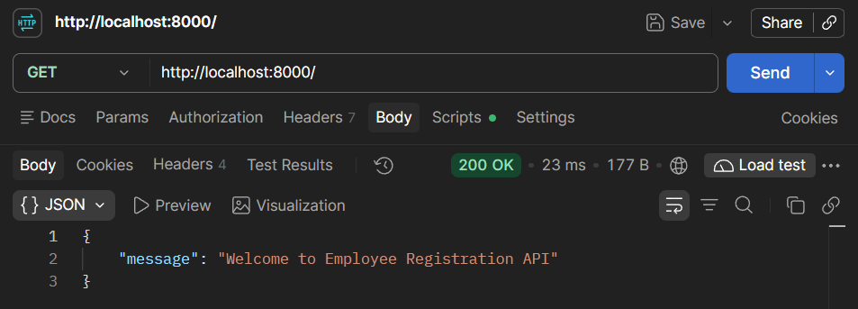

---

### Test 2: Health Check

**Method:** GET  
**URL:** `http://127.0.0.1:8000/health`  
**Expected Status:** 200 OK  
**Actual Status:** Pending

**Expected Response:**

```json
{
  "status": "healthy"
}
```

**Screenshot:**

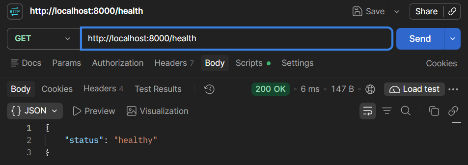

---

### Test 3: Register Employee — Valid Request

**Method:** POST  
**URL:** `http://127.0.0.1:8000/employees`  
**Expected Status:** 201 Created  
**Actual Status:** Pending

**Request Body:**

```json
{
  "name": "Rahul",
  "department": "Finance",
  "salary": 60000,
  "age": 26,
  "email": "rahul@example.com",
  "is_active": true
}
```

**Expected Response:**

```json
{
  "id": 103,
  "name": "Rahul",
  "department": "Finance",
  "age": 26,
  "email": "rahul@example.com",
  "is_active": true
}
```

**Screenshot:**

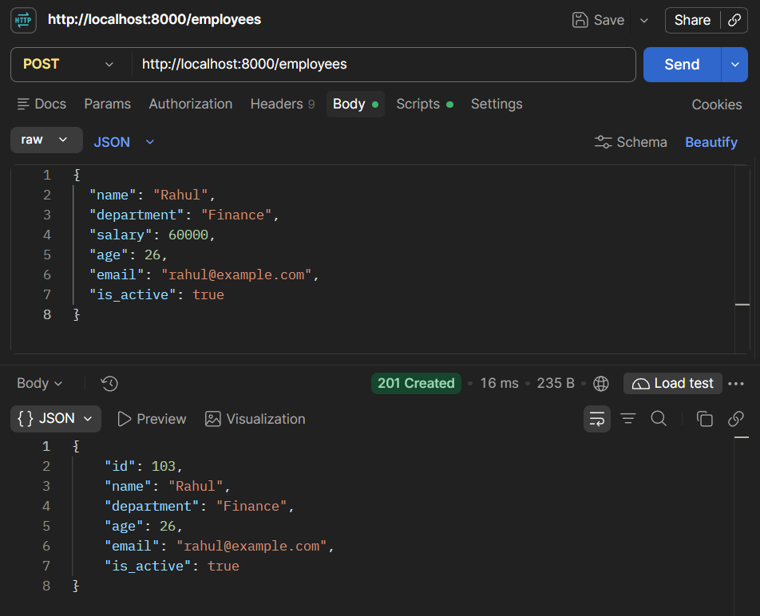

---

### Test 4: Register Employee — Optional Fields Omitted

**Method:** POST  
**URL:** `http://127.0.0.1:8000/employees`  
**Expected Status:** 201 Created  
**Actual Status:** Pending

**Request Body:**

```json
{
  "name": "Sneha",
  "department": "HR",
  "salary": 52000,
  "age": 24
}
```

**Expected Response:**

```json
{
  "id": 104,
  "name": "Sneha",
  "department": "HR",
  "age": 24,
  "email": null,
  "is_active": true
}
```

**Screenshot:**


---

### Test 5: Retrieve All Employees

**Method:** GET  
**URL:** `http://127.0.0.1:8000/employees`  
**Expected Status:** 200 OK  
**Actual Status:** Pending

**Expected Response:**

```json
[
  {
    "id": 101,
    "name": "Amit",
    "department": "IT",
    "age": 25,
    "email": "amit@example.com",
    "is_active": true
  },
  {
    "id": 102,
    "name": "Priya",
    "department": "HR",
    "age": 27,
    "email": null,
    "is_active": true
  },
  {
    "id": 103,
    "name": "Rahul",
    "department": "Finance",
    "age": 26,
    "email": "rahul@example.com",
    "is_active": true
  },
  {
    "id": 104,
    "name": "Sneha",
    "department": "HR",
    "age": 24,
    "email": null,
    "is_active": true
  }
]
```

**Screenshot:**

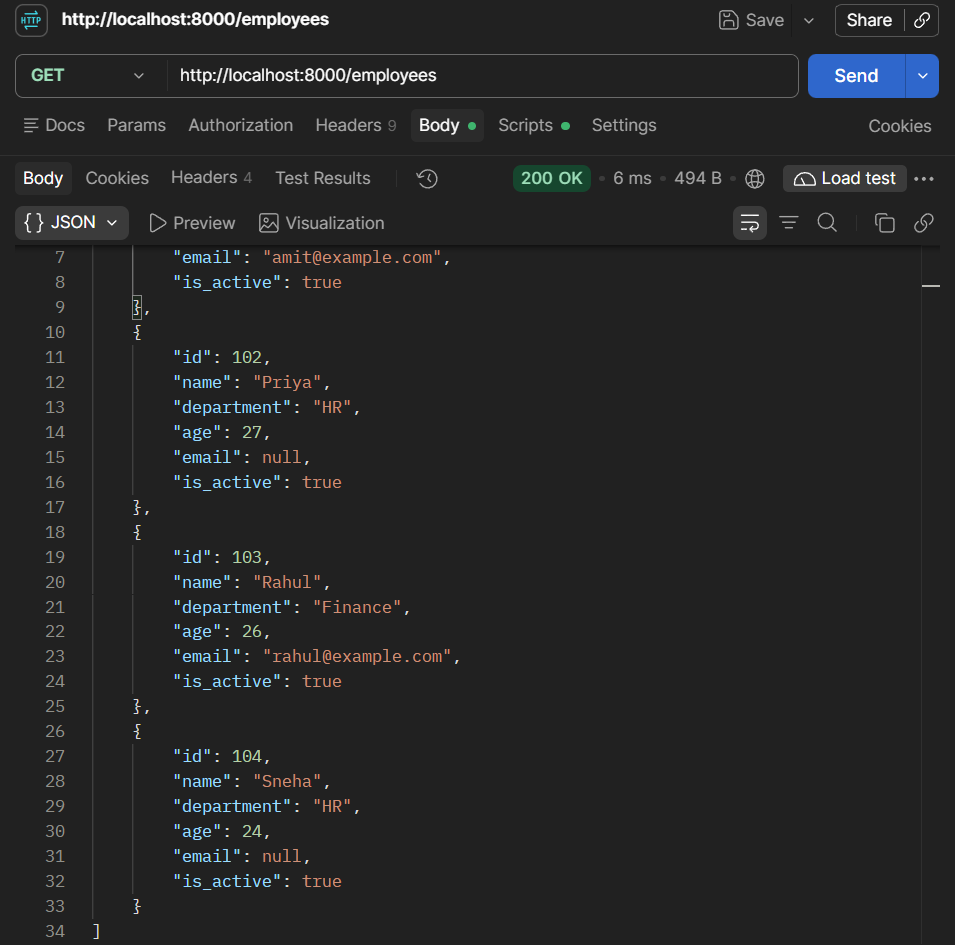

---

### Test 6: Retrieve Employee by ID

**Method:** GET  
**URL:** `http://127.0.0.1:8000/employees/103`  
**Expected Status:** 200 OK  
**Actual Status:** Pending

**Expected Response:**

```json
{
  "id": 103,
  "name": "Rahul",
  "department": "Finance",
  "age": 26,
  "email": "rahul@example.com",
  "is_active": true
}
```

**Screenshot:**

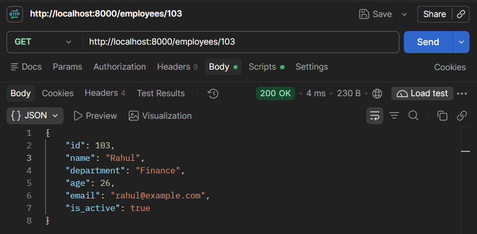

---

### Test 7: Employee Not Found

**Method:** GET  
**URL:** `http://127.0.0.1:8000/employees/999`  
**Expected Status:** 404 Not Found  
**Actual Status:** Pending

**Expected Response:**

```json
{
  "detail": "Employee not found"
}
```

**Screenshot:**

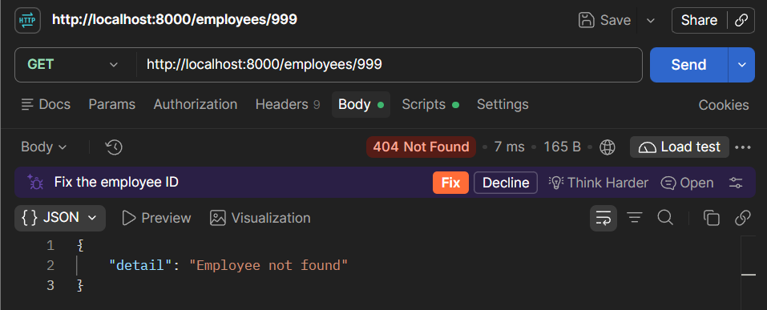

---

### Test 8: Missing Required Field

**Method:** POST  
**URL:** `http://127.0.0.1:8000/employees`  
**Expected Status:** 422 Unprocessable Content  
**Actual Status:** Pending

**Request Body:**

```json
{
  "name": "Karan",
  "department": "IT",
  "age": 28
}
```

**Expected Result:**

Validation error indicating that the required `salary` field is missing.

**Screenshot:**

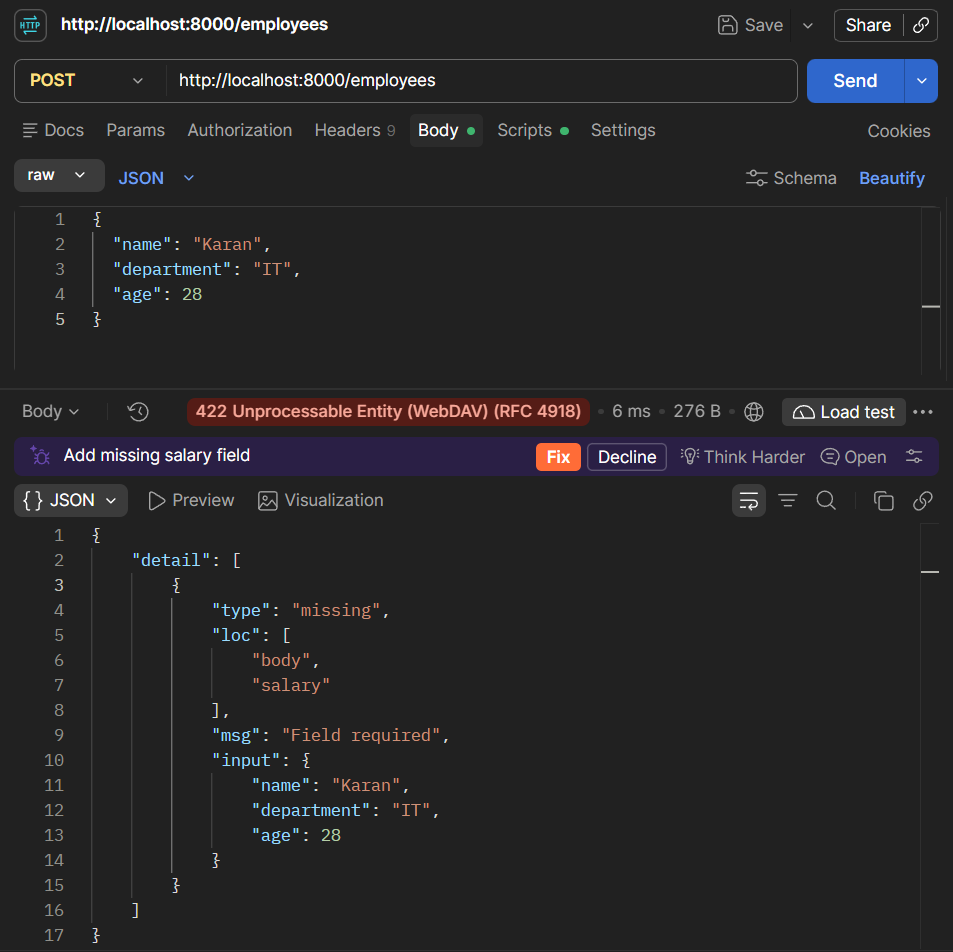

---

### Test 9: Invalid Field Constraints

**Method:** POST  
**URL:** `http://127.0.0.1:8000/employees`  
**Expected Status:** 422 Unprocessable Content  
**Actual Status:** Pending

**Request Body:**

```json
{
  "name": "A",
  "department": "IT",
  "salary": -5000,
  "age": 16
}
```

**Expected Result:**

Validation errors for:

- Name shorter than the minimum length.
- Salary not greater than zero.
- Age below the permitted minimum.

**Screenshot:**

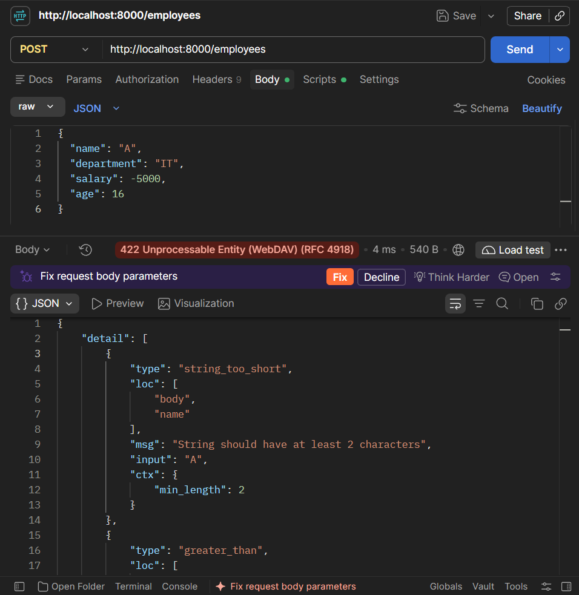

---

### Test 10: Invalid Data Type

**Method:** POST  
**URL:** `http://127.0.0.1:8000/employees`  
**Expected Status:** 422 Unprocessable Content  
**Actual Status:** Pending

**Request Body:**

```json
{
  "name": "Rohan",
  "department": "IT",
  "salary": "invalid",
  "age": "twenty"
}
```

**Expected Result:**

Validation errors indicating that salary cannot be parsed as a number and age must be an integer.

**Screenshot:**

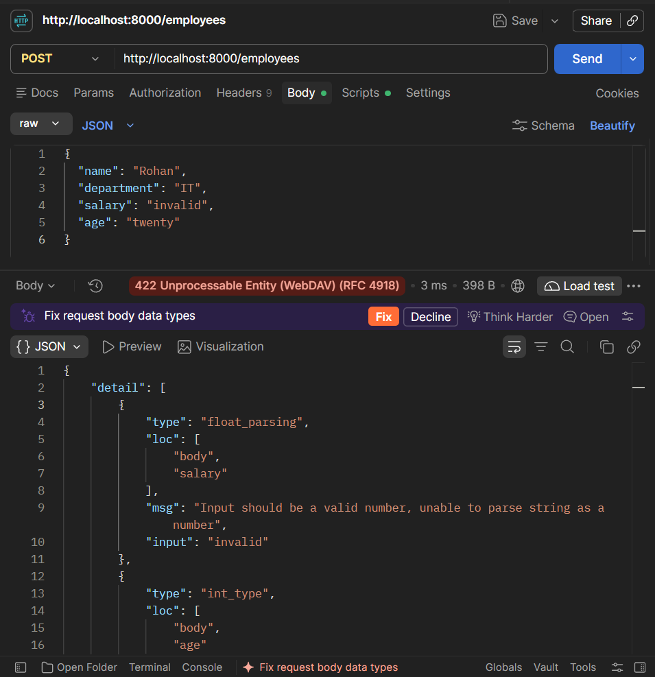

---

### Test 11: Unexpected Request Field

**Method:** POST  
**URL:** `http://127.0.0.1:8000/employees`  
**Expected Status:** 422 Unprocessable Content  
**Actual Status:** Pending

**Request Body:**

```json
{
  "name": "Neha",
  "department": "IT",
  "salary": 45000,
  "age": 23,
  "password": "example123"
}
```

**Expected Result:**

Validation error indicating that the additional `password` field is not permitted.

**Screenshot:**

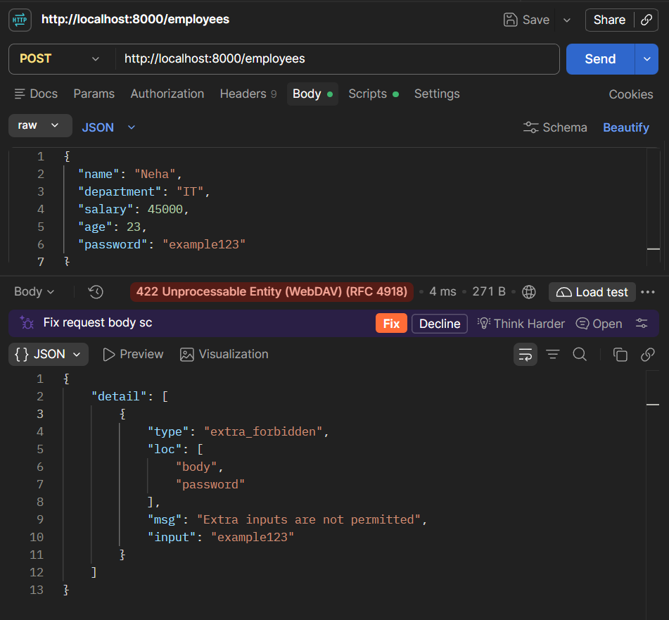

---

### Test 12: Swagger UI Documentation

**Method:** GET  
**URL:** `http://127.0.0.1:8000/docs`  
**Expected Status:** 200 OK  
**Actual Status:** Pending

**Expected Result:**

Swagger UI displays:

- Registered API endpoints.
- `EmployeeCreate` request schema.
- `EmployeeResponse` response schema.
- Required and optional fields.
- Field constraints.
- Validation error responses.

**Screenshot:**

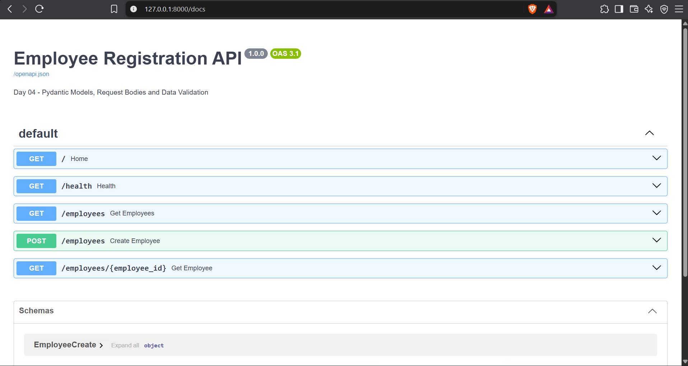

---

## 5. Key Learnings

- Pydantic validates structured data using Python type annotations.
- `BaseModel` defines reusable request and response models.
- FastAPI automatically parses JSON request bodies.
- `Field()` enforces string length and numeric constraints.
- Required fields must be supplied by the client.
- Optional fields can use default values.
- `model_dump()` converts Pydantic models into dictionaries.
- `response_model` validates and filters outgoing data.
- Invalid request data produces HTTP 422 validation errors.
- `HTTPException` provides structured HTTP error handling.
- In-memory storage is temporary and resets when the application restarts.

---

## 6. Final Status

| Requirement | Status |
|---|---|
| FastAPI source code prepared | Complete |
| Pydantic request model | Prepared |
| Pydantic response model | Prepared |
| Required and optional fields | Prepared |
| Field constraints | Prepared |
| Employee registration | Prepared |
| Automatic ID generation | Prepared |
| Employee retrieval | Prepared |
| 404 error handling | Prepared |
| Automatic 422 validation | Prepared |
| Response filtering | Prepared |
| Swagger UI documentation | Ready to verify |
| Postman testing | Pending |
| Screenshots captured | Pending |
| Documentation verified | Pending |
| GitHub upload | Pending |

**Day 04 Status:** Implementation prepared — awaiting execution and testing.

**Next Session:** Day 05 — CRUD Operations with FastAPI (POST, PUT, PATCH & DELETE).